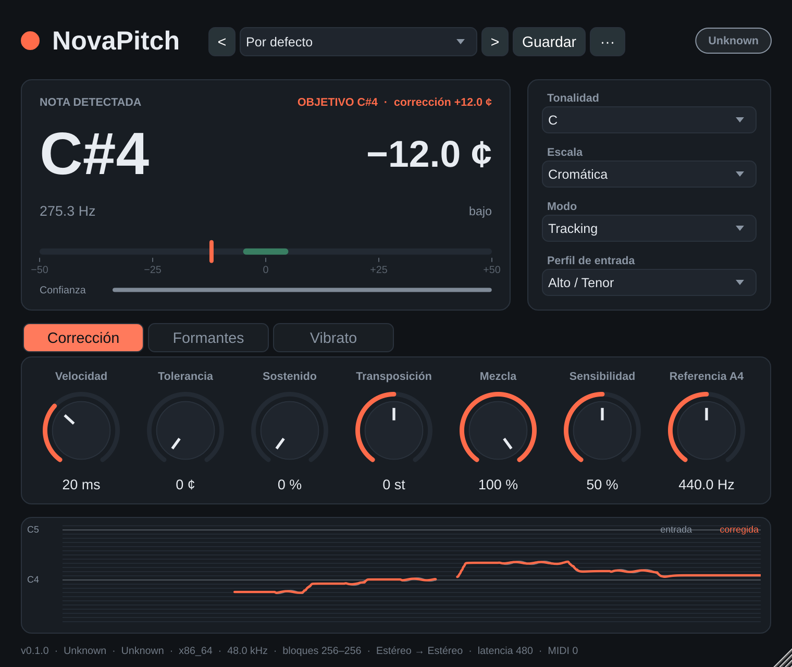

# NovaPitch

Plugin de **corrección de afinación vocal en tiempo real** (monofónico) para **FL Studio en Windows y macOS**, también compatible con cualquier DAW que cargue VST3, AU o CLAP.

> Nombre de trabajo. Verificar disponibilidad de la marca antes de publicar.



**Estado:** Fase 6 — corrección automática en tiempo real (tonalidad y 14 escalas, velocidad, tolerancia, sostenido natural, transposición ±12, mezcla) con 4 modos (Live 3 ms, Tracking 10 ms, HQ 100 ms, Vintage), formantes, vibrato natural/artificial, presets de fábrica y de usuario, MIDI Learn y color de acento. Siguiente: armonías y MIDI (Fase 7). Ver `docs/ROADMAP.md`.

| Formato | Windows x64 | macOS Universal (Apple Silicon + Intel) | Linux (opcional) |
|---|---|---|---|
| VST3 | ✅ | ✅ | ✅ |
| CLAP | ✅ | ✅ | ✅ |
| AU | — | ✅ | — |
| Standalone | ✅ | ✅ | ✅ |
| AAX | preparado, desactivado | preparado, desactivado | — |

FL Studio carga VST3 y CLAP (Windows y Mac) y AU (Mac). FL Studio **no** soporta ARA.

---

## Requisitos para compilar

**Windows**
- Visual Studio 2022 o posterior con la carga de trabajo *Desarrollo para el escritorio con C++* (CMake usa automáticamente la versión más nueva instalada)
- CMake ≥ 3.25 y Git

**macOS**
- Xcode ≥ 15 + Command Line Tools (`xcode-select --install`)
- CMake ≥ 3.25 (`brew install cmake`) y Git

**Linux (opcional)**: GCC ≥ 11 o Clang ≥ 14, CMake, Ninja y las dependencias de JUCE (`libasound2-dev libx11-dev libxrandr-dev libxcursor-dev libxinerama-dev libxext-dev libfreetype-dev libfontconfig1-dev libgl1-mesa-dev`).

## Compilar

```bash
git clone --recursive https://github.com/AlejandroMolinaDev/afinador.git
cd afinador
```
(Si ya lo clonaste sin `--recursive`: `git submodule update --init --recursive`.)

**Windows** (PowerShell o "Developer Command Prompt"):
```bash
cmake -B build -A x64
cmake --build build --config Release
ctest --test-dir build -C Release
```

**macOS**:
```bash
cmake -B build -DCMAKE_BUILD_TYPE=Release -DCMAKE_OSX_ARCHITECTURES="arm64;x86_64"
cmake --build build --config Release --parallel
ctest --test-dir build -C Release
```

Los plugins quedan en `build/NovaPitch_artefacts/Release/` (`VST3/`, `CLAP/`, `AU/`, `Standalone/`).

## Instalar y probar en FL Studio

### Windows
En una PowerShell **como administrador**:
```bash
powershell -ExecutionPolicy Bypass -File tools\install_plugins.ps1
```
Copia a `C:\Program Files\Common Files\VST3\NovaPitch.vst3` y `C:\Program Files\Common Files\CLAP\NovaPitch.clap`.

Sin permisos de administrador: añade `-UserFolder` (copia a `Documentos\NovaPitch-dev\`) y agrega esa carpeta en FL Studio → *Options → Manage plugins → Plugin search paths*.

Cierra FL Studio antes de reinstalar (mantiene el DLL bloqueado).

### macOS
```bash
./tools/install_plugins.sh
```
Copia a `~/Library/Audio/Plug-Ins/{VST3,Components,CLAP}`, firma ad-hoc y refresca la caché de Audio Units.

Si usas el zip descargado de GitHub Actions, quita la cuarentena antes de copiar:
```bash
xattr -dr com.apple.quarantine NovaPitch.vst3 NovaPitch.component NovaPitch.clap
```

### En FL Studio
1. *Options → Manage plugins → Find more plugins* (o *Find installed plugins*).
2. Busca **NovaPitch** (aparecerá como VST3, CLAP y, en Mac, AU; son entradas separadas).
3. Mixer → un slot de insert → NovaPitch.
4. La ventana muestra "FL Studio detectado", el formato cargado, frecuencia de muestreo, tamaños de bloque, canales y eventos MIDI recibidos.

Checklist completo de pruebas manuales: [`docs/TESTING_FL.md`](docs/TESTING_FL.md).

## Presets y MIDI Learn
- **Presets**: selector en la cabecera (`<` `>` para recorrerlos, **Guardar** para crear uno de usuario). Los presets cambian el sonido, nunca la tonalidad, la escala, las notas ni la referencia A4. Los de usuario se guardan en `Documentos/NovaPitch/Presets` (archivos `.novapreset`, se pueden copiar entre equipos).
- **MIDI Learn**: clic derecho sobre cualquier knob → *Asignar a controlador MIDI (aprender)* y mueve un control de tu teclado/controlador. Funciona en CLAP, AU y Standalone. En **VST3 dentro de FL Studio** usa *Link to controller* de FL (FL no envía CC a efectos VST3).
- **Color de acento**: botón `···` de la cabecera.

## Probar sin DAW: render offline
`NovaPitchRender` procesa un WAV/AIFF/FLAC con los parámetros que quieras y compensa la latencia, para comparar antes/después con tus propias tomas:
```bash
build/tools/NovaPitchRender mi_voz.wav mi_voz_hardtune.wav key=9 scale=1 retuneSpeed=0
```
Sin argumentos lista todos los parámetros (IDs y valores por defecto). `tools/demo/run_demo.sh` genera una frase sintética desafinada, la procesa con varios ajustes y dibuja el pitch antes/después (requiere Python con numpy y matplotlib); la CI publica ese resultado en el artefacto `Audio-demo`.

## Integración continua y pruebas automáticas
GitHub Actions compila en Windows x64, macOS Universal y Linux y ejecuta:
- tests unitarios (Catch2) con señales sintéticas (precisión de detección < 5 cents);
- **host test** (`tools/hosttest`): carga el binario VST3 (y AU en Mac) como lo haría un DAW y simula el comportamiento de FL Studio (bloques irregulares y vacíos, cambios de sample rate, automatización, MIDI, bypass, guardar/reabrir, varias instancias, latencia, abrir/cerrar editor mientras suena);
- **pluginval (strictness 10)**, `auval` (Mac) y **clap-validator**;
- benchmark de CPU (aparece en el resumen de la ejecución) y capturas de la interfaz (`UI-snapshots-*`).

Los binarios quedan como artefactos descargables de cada ejecución (pestaña *Actions*). FL Studio no puede ejecutarse en CI, por eso la prueba final con voz real sigue en `docs/TESTING_FL.md`.

## Licencias
- **JUCE 8**: licencia comercial (plan *Starter* gratuito hasta el límite de ingresos de JUCE) **o** AGPLv3. Para distribuir NovaPitch como software cerrado necesitas una licencia JUCE adecuada a tus ingresos.
- **VST3 SDK** (incluido en JUCE): MIT desde la versión 3.8.
- **CLAP** y **clap-juce-extensions**: MIT.
- **signalsmith-stretch** y **signalsmith-linear** (motor HQ): MIT.
- **Catch2**: Boost Software License 1.0 (solo tests).

Detalle en [`THIRD_PARTY_LICENSES.md`](THIRD_PARTY_LICENSES.md).

NovaPitch es una implementación original. No usa código, nombres ni diseño de productos comerciales de terceros.
