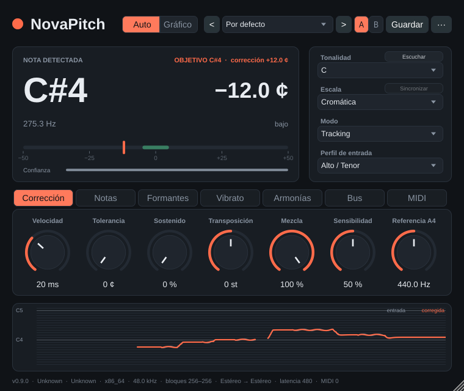
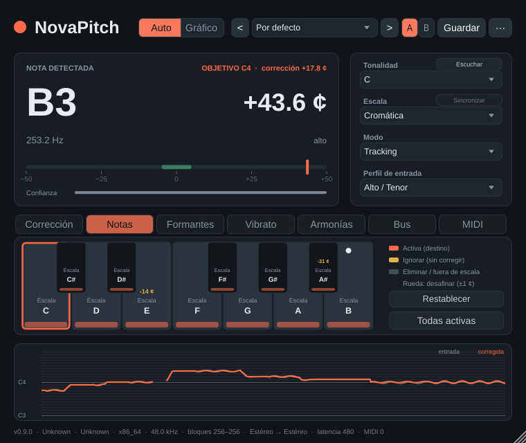
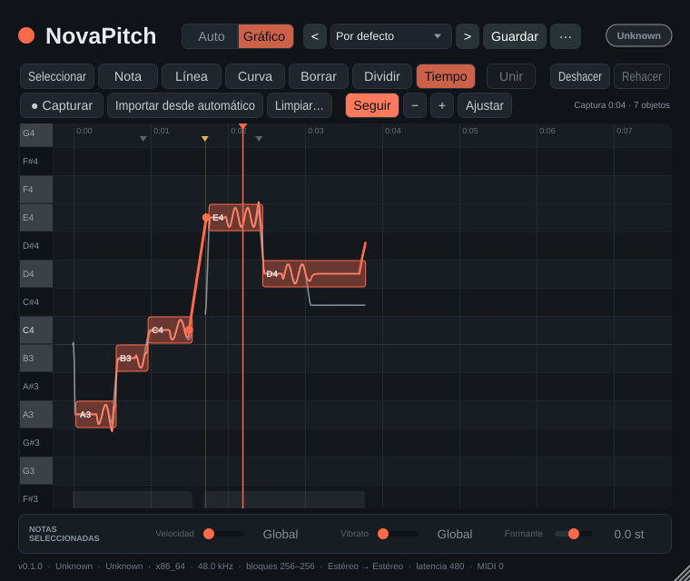

# NovaPitch — Guía de usuario

NovaPitch es un plugin de **corrección de afinación vocal en tiempo real** para voces monofónicas (una sola nota a la vez). Está pensado ante todo para **FL Studio en Windows y macOS**, y funciona en cualquier programa que cargue VST3, CLAP o AU.

Tiene dos formas de trabajar:

- **Auto**: corrige en tiempo real según la tonalidad y la escala (o las notas MIDI que toques). Ideal para grabar, para directo y para un afinado rápido.
- **Gráfico**: capturas la voz reproduciendo la canción, y después editas nota por nota la afinación y el tiempo. Ideal para un afinado detallado en mezcla.

---

## 1. Requisitos

| | Windows | macOS |
|---|---|---|
| Sistema | Windows 10 u 11 de 64 bits | macOS 10.13 o posterior, Apple Silicon (nativo) o Intel |
| Formatos | VST3, CLAP, aplicación independiente | VST3, AU, CLAP, aplicación independiente |
| Host recomendado | FL Studio (VST3) | FL Studio (VST3 o AU) |

FL Studio no necesita ningún paso especial: NovaPitch se instala en las carpetas estándar de plugins que FL ya examina.

---

## 2. Instalación

### Windows
1. Ejecuta `NovaPitch-<versión>-Windows-x64-Setup.exe` (pide permisos de administrador).
2. Elige los componentes: **VST3** (recomendado para FL Studio), **CLAP** y la **aplicación independiente**.
3. Se instalan en:
   - VST3: `C:\Program Files\Common Files\VST3\NovaPitch.vst3`
   - CLAP: `C:\Program Files\Common Files\CLAP\NovaPitch.clap`
   - Aplicación y esta guía: `C:\Program Files\NovaPitch\`

Si FL Studio está abierto y usando NovaPitch, el instalador te pedirá cerrarlo antes de actualizar.

### macOS
1. Abre `NovaPitch-<versión>-macOS.pkg` y sigue el asistente (puedes elegir componentes en *Personalizar*).
2. Se instalan en:
   - VST3: `/Library/Audio/Plug-Ins/VST3/NovaPitch.vst3`
   - AU: `/Library/Audio/Plug-Ins/Components/NovaPitch.component`
   - CLAP: `/Library/Audio/Plug-Ins/CLAP/NovaPitch.clap`
   - Aplicación: `/Applications/NovaPitch.app`
   - Esta guía: `/Library/Application Support/NovaPitch/`

> Si macOS dice que el paquete «no se puede abrir porque procede de un desarrollador no identificado» (versiones de prueba sin firma de Apple): clic derecho sobre el `.pkg` → **Abrir** → **Abrir**. Las versiones publicadas van firmadas y notarizadas.

### Linux (opcional)
Descomprime `NovaPitch-Linux-x64.tar.gz` y ejecuta `./install_plugins.sh`: copia el VST3 a `~/.vst3` y el CLAP a `~/.clap`.

### Desinstalar
- **Windows**: *Configuración → Aplicaciones → NovaPitch → Desinstalar*.
- **macOS**: borra los archivos de las rutas de arriba.

Tus presets (`Documentos/NovaPitch/Presets`) y las capturas de audio del modo gráfico (ver §12.7) no se borran al desinstalar.

---

## 3. Primeros pasos en FL Studio

1. **Escanear**: *Options → Manage plugins → Find installed plugins* (o *Start scan*). NovaPitch aparece como efecto de *NovaPitch Audio*. Marca la estrella para tenerlo en favoritos.
2. **Insertar**: en el **Mixer**, selecciona la pista de la voz y añade NovaPitch en un slot. Debe ir **antes** de reverbs y delays.
3. **Tonalidad y escala**: elige la tonalidad de la canción en **Tonalidad** y la escala en **Escala** (o pulsa **Escuchar** para que la detecte, §11).
4. Canta o reproduce la voz: el medidor muestra la nota detectada y la corrección.
5. Ajusta la **Velocidad**: 20–60 ms suena natural; 0 ms da el efecto robótico de afinación instantánea.

El indicador **FL Studio** de la cabecera confirma que el plugin ha reconocido el host. La latencia del modo elegido se comunica a FL y su compensación de retardo (PDC) la corrige sola: no hay que mover nada.

---

## 4. Pantalla principal

| Zona | Qué hace |
|---|---|
| **Auto / Gráfico** | Cambia entre corrección automática y modo gráfico (§12). Es un parámetro automatizable (*Modo gráfico*). |
| **Presets** `<` `>` · **A / B** · **Guardar** · `···` | Presets de fábrica y de usuario (§10) y comparación A/B; «*» junto al nombre = ajustes cambiados. `···` abre opciones: color de acento, carpeta de presets, carpeta de capturas de audio, copiar A en B, quitar asignaciones MIDI. |
| **Medidor** | Nota detectada, desviación en cents (¢), nota destino y corrección aplicada; barra de confianza de la detección. |
| **Tonalidad / Escala** | Notas destino. 14 escalas (Mayor, menores, modos, pentatónicas, Blues, Cromática y Personalizada). Botones **Escuchar** y **Sincronizar** (§11). |
| **Modo** | Live, Tracking, HQ o Vintage (§5). |
| **Perfil de entrada** | Rango en el que se busca la nota (§6). |
| **Pestañas** | Corrección, Notas, Formantes, Vibrato, Armonías, Bus, MIDI. |
| **Gráfico inferior** | Últimos 5 s: afinación de entrada y corregida. |
| **Pie** | Versión, formato, host, frecuencia de muestreo, bloques, canales, latencia y mensajes de estado. |

La ventana se puede redimensionar del 75 % al 200 % arrastrando la esquina inferior derecha.

---

## 5. Modos de calidad y latencia

| Modo | Latencia | Uso recomendado |
|---|---|---|
| **Live** | ~3 ms | Directo y monitorizar mientras cantas. |
| **Tracking** (por defecto) | ~10 ms | Grabar y producir: preciso y ligero. |
| **HQ** | ~100 ms | Mezcla y exportación: motor de máxima calidad, más CPU. |
| **Vintage** | ~3 ms | Efecto «hard tune» clásico: saltos instantáneos, sin vibrato, formantes sin preservar. |

Al cambiar de modo cambia la latencia; FL la compensa automáticamente. Para cantar con monitorización usa Live o Tracking; deja HQ para la mezcla.

---

## 6. Pestaña Corrección

| Control | Rango | Qué hace |
|---|---|---|
| **Velocidad** | 0–400 ms | Tiempo que tarda en llegar a la nota. 0 = salto instantáneo; valores altos = corrección suave que deja pasar el vibrato. |
| **Tolerancia** | 0–100 ¢ | Solo corrige cuando la voz ya está cerca de la nota: deja pasar glissandos, scoops y adornos. 0 = corrige siempre. |
| **Sostenido** | 0–100 % | En notas largas y estables suaviza la corrección para conservar las micro-variaciones, manteniendo precisos los ataques. |
| **Transposición** | ±12 semitonos | Desplaza la voz corregida. |
| **Mezcla** | 0–100 % | Proporción entre la voz original (con su retardo compensado) y la corregida. |
| **Sensibilidad** | 0–100 % | Cuánto ruido o aire tolera la detección. Súbela para voces susurradas; bájala si la detección salta en respiraciones o sibilantes. |
| **Referencia A4** | 400–480 Hz | Frecuencia del La 4 (440 Hz es el estándar). |

**Perfil de entrada**: *Soprano* (150–1200 Hz), *Alto / Tenor* (80–900 Hz, por defecto), *Voz grave masculina* (60–500 Hz), *Instrumento* (50–2000 Hz), *Instrumento grave* (30–400 Hz). Un perfil ajustado a la voz evita errores de octava.

### Pestaña Notas

Un teclado de una octava con las 12 notas. Cada nota tiene un estado:
- **Escala** (por defecto): sigue a la tonalidad y la escala elegidas.
- **Activa**: destino válido aunque no esté en la escala.
- **Ignorar**: no se corrige; pasa la voz original (útil para una nota de paso o un adorno).
- **Eliminar**: no es destino; se corrige a la nota válida más cercana.

**Clic** en una tecla pasa al siguiente estado; **clic derecho** permite elegirlo o desafinar la nota. El color muestra el resultado real (acento = destino, amarillo = ignorar, gris = eliminada o fuera de escala). El **punto blanco** marca la nota que estás cantando y el **contorno** la nota a la que se corrige. **Restablecer** vuelve todas a «Escala»; **Todas activas** equivale a la escala cromática. Los estados también son parámetros automatizables (`Nota C`, `Nota C#`…) y **Aprender escala por MIDI** (§10) los rellena por ti.

**Desafinación por nota** (escalas microtonales, entonación justa, cuartos de tono): cada nota puede corregirse hasta ±50 ¢ por encima o por debajo del temperamento igual. Gira la **rueda del ratón** sobre la tecla (±1 ¢; con Mayús ±10 ¢) o usa **clic derecho → Desafinación** (valores rápidos como −14 ¢ para una tercera mayor justa, −31 ¢ para una séptima armónica, ±50 ¢ para cuartos de tono, u *Otro valor…*). La tecla muestra el valor en amarillo. La desafinación también decide a qué nota se corrige, y la respetan las armonías, la nota objetivo MIDI, la importación del modo gráfico y **Sincronizar**. Como la tonalidad, pertenece a la canción: los presets y el A/B no la cambian.

---

## 7. Formantes

Los formantes son el «color» o timbre de la voz, independiente de la nota.

- **Preservar formantes** (activado por defecto): al cambiar la nota, el timbre se mantiene (sin voz de «ardilla» ni de «monstruo»).
- **Enlazar a transposición**: los formantes se mueven junto con la Transposición (diseño vocal creativo).
- **Desplazar** (±12 st): voz más aguda/infantil (+) o más grave/oscura (−) sin cambiar la afinación.
- **Carácter** (±50 %): simula un tracto vocal más corto (+) o más largo (−).

En modo Vintage los formantes siguen a la nota (efecto clásico).

---

## 8. Vibrato

- **Conservar** (0–200 %): la corrección actúa sobre el centro de la nota y el vibrato natural se mantiene (100 %), se elimina (0 %) o se exagera (200 %). NovaPitch necesita ~0,6 s de nota para reconocer el vibrato.
- **Vibrato artificial**: **Forma** (seno, triángulo, cuadrada o sierra), **Velocidad** (0,1–10 Hz), **Profundidad** (cents; 0 = apagado), **Retardo** (desde el inicio de cada nota), **Variación** (menos mecánico), **Amplitud** (modulación de volumen) y **Formante** (cuánto sigue el timbre al vibrato).

El visualizador muestra la velocidad y profundidad detectadas y la oscilación en vivo.

---

## 9. Armonías y Bus

Hasta **4 voces** generadas a partir de tu voz, alineadas con la voz corregida en todos los modos.

- **Modo**: *Diatónica* (intervalo en grados de la escala: la 3ª será mayor o menor según la nota), *Semitonos* (intervalo fijo), *MIDI* (cada voz canta una nota del acorde que tocas, §9.1) o *Apagada*.
- **Intervalo / Semitonos**, **Formante** (timbre propio), **Panorama**, **Nivel**, **Humanizar** (micro-desafinación y retardo para que no suene a copia), **Mute** y **Solo**.
- **Bus** (todas las voces): paso-alto, paso-bajo, EQ de campana, ataque y liberación, **Gate** (por debajo de ese nivel de entrada las armonías se callan) y **Ancho** estéreo.

Preset de ejemplo: **Armonías 3as** (3ª arriba y 3ª abajo).

### 9.1 Enviar MIDI a NovaPitch en FL Studio
1. En la ventana del plugin: icono de engranaje (*Settings*) → **MIDI** → **Input port** = 1 (u otro número libre).
2. En el Channel Rack añade un canal **MIDI Out** con el mismo **Port**.
3. Escribe notas o acordes en el **Piano roll** de ese canal.

Con eso funcionan: armonías en modo MIDI (acordes), **MIDI: nota objetivo** y **Aprender escala**. La pestaña **MIDI** muestra las notas que llegan.

---

## 10. MIDI, presets y MIDI Learn

- **MIDI: nota objetivo**: la nota MIDI que mantienes (en la octava más cercana a la voz) es el destino de la corrección. Puedes cantar en cualquier octava. Con **Octava exacta**, se usa la nota en la octava que tocas (para forzar saltos de octava).
- **Enviar notas MIDI**: NovaPitch envía como MIDI las notas corregidas que va cantando la voz (con su intensidad), para doblarla con un sintetizador o escribirlas en el Piano roll. En FL Studio: ventana del plugin → ⚙ → **MIDI** → **Output port** = un número libre; en el sintetizador, el mismo número como *Input port*.
- **Aprender escala por MIDI**: mientras está activo, las notas que toques definen una escala personalizada (Escala = Personalizada). Desactívalo para conservarla.
- **Comparación A/B**: los botones **A** y **B** de la cabecera guardan dos versiones del sonido; pulsa el otro para compararlas mientras suena la canción (la primera vez, B empieza como copia de A). `···` → *Copiar el sonido A en B* iguala ambas. Las dos se guardan con el proyecto y nunca cambian la tonalidad, la escala ni las notas.
- **Presets**: los de fábrica (*Corrección natural, Pop moderno, Hard tune, Trap / urbano latino, Directo, Voz grave, Armonías 3as*) y los tuyos (**Guardar**, en `Documentos/NovaPitch/Presets`). Un preset cambia el sonido **pero nunca** la tonalidad, la escala, las notas (ni su desafinación), la referencia A4 ni el modo gráfico: puedes probar presets a mitad de canción sin perder la tonalidad. Si tocas un ajuste, el nombre muestra «*»; elegir el mismo preset otra vez descarta los cambios.
- **MIDI Learn** (CLAP, AU y aplicación independiente): clic derecho en cualquier knob → *Asignar a controlador MIDI* y mueve un control de tu teclado. Las asignaciones se guardan en el proyecto.
- **En VST3 dentro de FL Studio** usa *Link to controller* de FL (clic derecho en el knob dentro de FL o *Tools → Last tweaked → Link to controller*): FL no envía CC a los efectos VST3.

---

## 11. Tonalidad automática y varias pistas

- **Escuchar** (junto a *Tonalidad*): elige 10, 20 o 30 s; reproduce o canta. Solo cuentan los tramos con voz. Al terminar se ajustan **Tonalidad** y **Escala** (Mayor o Menor natural) y el pie muestra la tonalidad detectada y la confianza. *Detener y aplicar* termina antes.
- **Desde la captura del modo gráfico**: detecta la tonalidad de toda la voz capturada, sin volver a reproducir.
- Una tonalidad mayor y su relativa menor (p. ej. Do mayor y La menor) tienen las mismas notas: para afinar da igual cuál se elija.
- **Sincronizar** (junto a *Escala*): envía tonalidad, escala, estados de nota y A4 a **todas las demás instancias de NovaPitch** del proyecto (voz principal, coros, dobles…). Si FL abre el plugin en modo *bridged* (proceso aparte), las instancias no se ven entre sí y el botón aparece desactivado.

---

## 12. Modo gráfico

FL Studio no admite ARA, así que NovaPitch trabaja por **captura por reproducción**: registra la voz mientras FL reproduce, indexada por la posición de la canción.

### 12.1 Flujo de trabajo
1. Pulsa **Gráfico** en la cabecera.
2. Pulsa **● Capturar** y reproduce la canción (o el tramo) en FL. La curva de afinación se dibuja en rojo y queda en gris al parar. Volver a capturar un tramo sustituye solo ese tramo.
3. Pulsa **Importar desde automático** y elige:
   - **Notas** con detalle *normal*, *más detalle* (pasajes rápidos y adornos) o *menos detalle* (notas largas), según la tonalidad y la escala actuales.
   - **Curvas**: curvas que siguen exactamente la afinación capturada; no cambian nada hasta que las editas (mover, redibujar o escalar su vibrato).

   Todo se puede deshacer.
4. Edita (§12.2). La **curva corregida** (color de acento) muestra el resultado previsto sobre la original (gris).
5. Reproduce: la voz sigue lo dibujado. **Fuera de los objetos, o con el transporte parado, pasa la voz original.**

Todo se guarda con el proyecto de FL.

### 12.2 Herramientas
| Herramienta | Tecla | Uso |
|---|---|---|
| **Seleccionar** | 1 | Clic para elegir (Mayús: añadir), arrastrar para mover (las notas se mueven por semitonos; con **Alt**, libremente), bordes para cambiar la duración, arrastre en vacío para seleccionar varias. |
| **Nota** | 2 | Arrastra para dibujar una nota; un clic crea una de 250 ms. |
| **Línea** | 3 | Línea recta de afinación (deslizamientos entre notas). Alt: sin ajustar a semitonos. |
| **Curva** | 4 | Dibujo a mano alzada de la afinación exacta. |
| **Borrar** | 5 | Borra lo que toques o arrastres. |
| **Dividir** | 6 | Divide una nota donde hagas clic. |
| **Tiempo** | 7 | Corrección temporal (§12.4). |

- **Clic derecho** sobre un objeto lo borra (como en el Piano roll de FL), con cualquier herramienta.
- **Unir**: une las notas seleccionadas. **Deshacer / Rehacer**: ilimitado.
- **Limpiar…**: borrar objetos, borrar la curva capturada (y su audio), borrar todo, quitar ediciones de tiempo.
- **Seguir**: la vista acompaña a la reproducción. **− / +** y **Ajustar**: zoom.
- Rueda: tono · Mayús + rueda: tiempo · Ctrl/Cmd + rueda: zoom de tiempo · Alt + rueda: zoom de tono · pinza en trackpad: zoom.

### 12.3 Ajustes por nota (inspector)
Con notas seleccionadas, la barra inferior ajusta solo esas notas: **Velocidad**, **Vibrato** (conservado) y **Formante**. Con curvas seleccionadas, **Vibrato** escala la oscilación de la propia curva (0 % la aplana, 200 % la duplica). «Global» usa el valor de las pestañas. Un punto amarillo marca las notas con ajustes propios. Las líneas y curvas se siguen exactamente (sin suavizado ni vibrato).

### 12.4 Corrección temporal (herramienta Tiempo)
- Arrastra el **cuerpo** de una nota para mover la sílaba en el tiempo; arrastra un **borde** para estirarla o comprimirla. Las notas vecinas se ajustan para que no queden huecos ni solapes.
- Los triángulos de la regla marcan las anclas de tiempo (amarillos = desplazados).
- **Alt + clic** sobre la nota deshace su edición de tiempo; *Limpiar → Quitar ediciones de tiempo* las quita todas.
- Es **no destructivo**: NovaPitch reconstruye ese tramo a partir del audio capturado y lo reproduce en su lugar; el audio de tu proyecto nunca se modifica. Las ediciones de afinación siguen pegadas a su sílaba.
- Necesita la captura de audio (§12.7). Mientras se recalcula verás «Renderizando tiempo…» en la barra.

### 12.5 Automatización
El parámetro **Modo gráfico** se puede automatizar: por ejemplo, gráfico en las estrofas editadas a mano y automático en el resto.

### 12.6 Atajos de teclado
Supr / Retroceso: borrar · Ctrl/Cmd + Z: deshacer · Ctrl/Cmd + Mayús + Z o Ctrl + Y: rehacer · Ctrl/Cmd + A: seleccionar todo · Esc: quitar selección · 1–7: herramientas · Flechas ↑ ↓: ±1 semitono (Mayús: ±10 ¢) · Flechas ← →: ±10 ms (Mayús: ±100 ms). Haz clic en el gráfico antes para que la ventana del plugin tenga el foco del teclado (si FL se queda alguna tecla, usa los botones).

### 12.7 Dónde se guarda el audio capturado
Para no inflar el proyecto de FL, el audio capturado se guarda en tu carpeta de usuario (`···` → *Abrir carpeta de capturas de audio*):
- Windows: `%LOCALAPPDATA%\NovaPitch\Captures`
- macOS: `~/Library/Application Support/NovaPitch/Captures`

El proyecto guarda la curva de afinación, los objetos y la referencia a esas capturas. **Si llevas el proyecto a otro ordenador**, la afinación gráfica funciona igual, pero las ediciones de tiempo necesitan volver a capturar (aparece «Falta el audio capturado»). Si duplicas una pista con NovaPitch, las dos comparten la captura: borrarla en una la borra para las dos.

---

## 13. Rendimiento y consejos

- CPU orientativa a 48 kHz: Tracking ~2 % de un núcleo, HQ ~6 %, con 4 armonías ~4 %.
- Usa **Tracking** para grabar y **HQ** solo al mezclar o exportar.
- Coloca NovaPitch **antes** de compresores fuertes, reverbs y delays, y limpia la voz de ruido si la detección duda.
- Si la nota detectada salta de octava, ajusta el **Perfil de entrada**.
- Para el efecto robótico: preset **Hard tune** (o Velocidad 0, Tolerancia 0, Conservar vibrato 0 %), o modo **Vintage**. Los cambios de nota son inmediatos: la salida salta a la nota nueva en cuanto la cantas.

---

## 14. Solución de problemas

| Problema | Solución |
|---|---|
| FL no muestra NovaPitch | *Options → Manage plugins → Find installed plugins*. Comprueba la ruta del VST3 (§2). En macOS, abre una vez el `.pkg` con clic derecho → Abrir si no está firmado. |
| No corrige | ¿Hay voz monofónica clara? Revisa Tonalidad/Escala, que las notas no estén en *Ignorar*, la **Mezcla** al 100 % y que no estés en modo **Gráfico** sin objetos. |
| Desfase con el resto de pistas | Deja activada la compensación de retardo de FL (está por defecto). Cambiar de modo cambia la latencia; FL la reajusta sola. |
| Las armonías MIDI o MIDI Target no responden | Revisa el enrutado MIDI (§9.1): mismo número de puerto en el plugin y en el canal MIDI Out. La pestaña MIDI debe mostrar las notas. |
| MIDI Learn no aprende en VST3 | En FL usa *Link to controller* (§10). |
| Sincronizar desactivado | Solo hay una instancia en el proceso, o el plugin está en modo *bridged*. |
| «Falta el audio capturado» | Vuelve a capturar el tramo con ● Capturar. |
| Clics o cortes | Sube el tamaño de búfer de audio en FL o usa Tracking en lugar de HQ. |

---

## 15. Licencias de terceros

NovaPitch usa JUCE, el SDK de VST3, CLAP / clap-juce-extensions y signalsmith-stretch / signalsmith-linear. Las licencias están en `THIRD_PARTY_LICENSES.md` (instalado junto a la aplicación).
